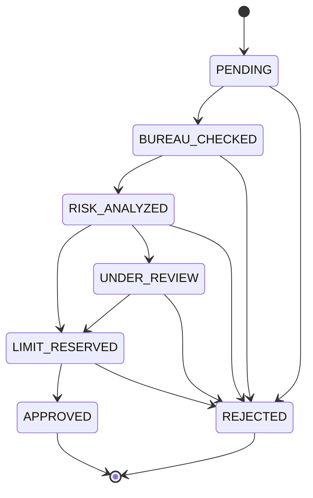
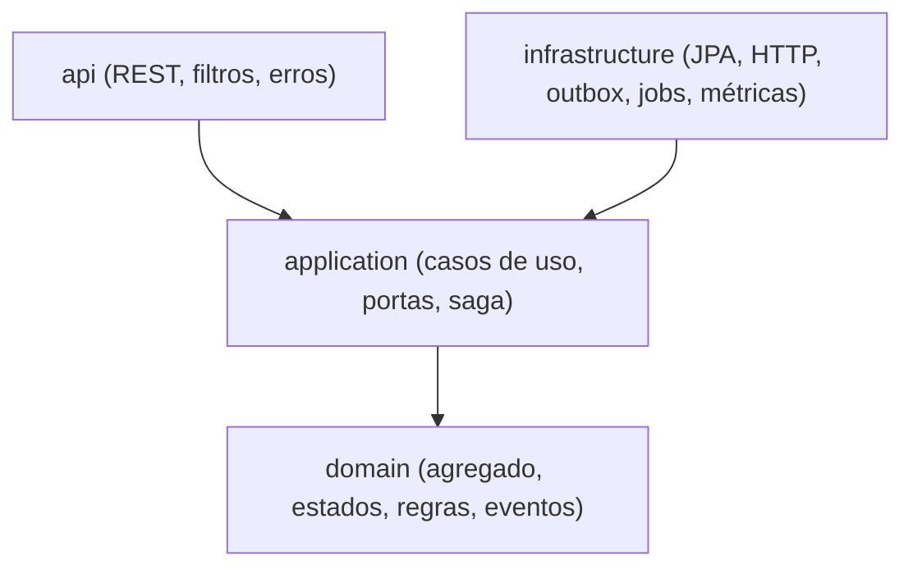

# Alcada

Serviço de aprovação e gestão de linhas de crédito em Java 21 e Spring Boot. Saga orquestrada com compensações, eventos via outbox, requisições idempotentes e recuperação automática de processos interrompidos.

[](https://github.com/nevvesdev/alcada/actions/workflows/ci.yaml)


## Visão geral

O cliente solicita um limite de crédito informando valor, CPF e renda declarada. A solicitação percorre etapas coordenadas por um orquestrador central: consulta ao bureau, análise de risco, reserva e confirmação do limite. Se uma etapa falha, as anteriores são compensadas.

## Destaques de engenharia

- **Saga orquestrada** com máquina de estados no domínio e compensações explícitas.
- **Idempotência** por `Idempotency-Key`, garantida por restrição no banco.
- **Outbox transacional** para publicação confiável de eventos.
- **Resiliência** nas integrações: timeouts, retry com backoff e jitter, circuit breaker.
- **Recuperação** de sagas paradas com lease e `SKIP LOCKED`, seguro para várias instâncias.
- **Onion architecture** com a regra de dependência verificada por ArchUnit.
- **Observabilidade:** métricas Prometheus, correlation id e logs estruturados.
- **Segurança:** CPF criptografado em repouso, mascarado em respostas e logs.

## Fluxo da saga

1. **Solicitação recebida:** `PENDING`, com chave de idempotência.
2. **Consulta ao bureau:** serviço externo de score. Status `BUREAU_CHECKED`.
3. **Análise de risco:** score, renda e valor solicitado. Pode aprovar, negar ou enviar para revisão. Status `RISK_ANALYZED`.
4. **Reserva de limite:** reserva o valor na conta do cliente. Status `LIMIT_RESERVED`.
5. **Aprovação final:** confirma o limite e emite o evento `CreditLineApproved`. Status `APPROVED`.

### Compensações

| Falha | Ação |
|---|---|
| Bureau indisponível após retries | `REJECTED (BUREAU_UNAVAILABLE)` |
| Score baixo ou renda incompatível | `REJECTED` com o motivo |
| Reserva de limite recusada | `REJECTED (LIMIT_RESERVATION_FAILED)` |
| Confirmação do limite falha | Libera a reserva e `REJECTED (APPROVAL_FAILED)` |
| Liberação da reserva falha | Permanece em `LIMIT_RESERVED` e é retomada pela recuperação |

### Máquina de estados



## Arquitetura

Onion Architecture: as dependências apontam sempre para o centro.



```text
src/main/java/br/com/nevvesdev/alcada/
├── domain/          agregado CreditRequest, value objects, RiskPolicy, eventos
├── application/     casos de uso, portas e orquestrador da saga
├── infrastructure/  persistência, adaptadores HTTP, outbox, jobs, métricas, segurança
└── api/             controller, DTOs, tratamento de erros e filtros
```

Mais detalhes em [`docs/design.md`](docs/design.md) e nas decisões em [`docs/adr`](docs/adr).

## API

Documentação interativa em `http://localhost:8080/swagger-ui.html` (OpenAPI em `/v3/api-docs`).

| Método | Caminho | Descrição |
|---|---|---|
| POST | `/api/v1/credit-requests` | Abre a solicitação e executa a saga. Exige o header `Idempotency-Key`. |
| GET | `/api/v1/credit-requests/{id}` | Consulta o estado da solicitação. |
| POST | `/api/v1/credit-requests/{id}/review/approve` | Aprova uma solicitação em revisão manual. |
| POST | `/api/v1/credit-requests/{id}/review/deny` | Nega uma solicitação em revisão manual. |

Respostas do `POST`: `201` quando a saga termina, `200` em repetição idempotente, `202` quando a infraestrutura interrompe a saga (a recuperação conclui depois). Erros seguem o formato `ProblemDetail` (RFC 7807) com um campo `code` estável. O CPF só aparece mascarado. Corpos acima de 16 KB recebem `413`.

## Demonstração

Suba o banco e o WireMock (que simula o bureau e o serviço de limite na porta 8089) e a aplicação:

```bash
docker-compose up -d
./mvnw spring-boot:run
```

```bash
curl -i -X POST http://localhost:8080/api/v1/credit-requests \
  -H 'Content-Type: application/json' \
  -H 'Idempotency-Key: demo-001' \
  -d '{"cpf":"529.982.247-25","requestedAmount":5000,"declaredIncome":4000}'
```

| CPF | Cenário |
|---|---|
| `529.982.247-25` | Score 720: aprovada |
| `111.444.777-35` | Score 300: rejeitada por score baixo |
| `123.456.789-09` | Score 500: segue para revisão manual |
| `935.411.347-80` | Bureau indisponível: retries e rejeição |

Repita o mesmo `curl` com a mesma chave para ver a resposta idempotente (`200`). Para forçar a recusa do serviço de limite, solicite um valor acima de 100.000 com renda compatível.

Para subir tudo em containers, incluindo a aplicação:

```bash
docker-compose -f docker-compose.yaml -f docker-compose.app.yaml up --build
```

## Observabilidade

- **Métricas** em `/actuator/prometheus`: `alcada_credit_request_outcome_total` (resultado por motivo), `alcada_outbox_pending` e `alcada_outbox_dead` (saúde do outbox), `alcada_outbox_published_total`, além das métricas de circuit breaker e retry do Resilience4j.
- **Correlation id:** o header `X-Correlation-Id` é aceito ou gerado, devolvido na resposta e incluído em todo log da requisição.
- **Logs estruturados em JSON** no perfil `container`.
- **Health checks** de liveness e readiness em `/actuator/health`.

## Segurança

- CPF criptografado em repouso com AES-256-GCM (ADR-0007), mascarado em respostas e logs e ausente dos eventos.
- Segredo fornecido por `ALCADA_CPF_SECRET`, obrigatório no perfil `container`.
- A imagem Docker roda com usuário não-root.
- A API não implementa autenticação: em produção ela fica atrás de um gateway.

## Configuração

| Variável | Descrição | Padrão local |
|---|---|---|
| `DB_URL` | URL JDBC do PostgreSQL | `jdbc:postgresql://localhost:5432/alcada` |
| `DB_USERNAME` | Usuário do banco | `alcada` |
| `DB_PASSWORD` | Senha do banco | `alcada` |
| `BUREAU_BASE_URL` | URL do bureau de crédito | `http://localhost:8089` |
| `LIMITS_BASE_URL` | URL do serviço de limite | `http://localhost:8089` |
| `ALCADA_CPF_SECRET` | Segredo de criptografia do CPF | valor de desenvolvimento (sem padrão no perfil `container`) |

Timeouts, retries, circuit breaker, jobs e outbox são configuráveis em `application.yaml`.

## Testes e qualidade

```bash
./mvnw verify
```

Requer Docker em execução (Testcontainers). A suíte cobre domínio, aplicação com dublês em memória, adaptadores HTTP com servidor de teste, persistência e concorrência (`SKIP LOCKED`) com PostgreSQL real, a API ponta a ponta e as regras de arquitetura. O build aplica um gate de cobertura de linhas com JaCoCo, e o relatório fica em `target/site/jacoco`.

O CI executa o `verify` e publica a imagem em `ghcr.io/nevvesdev/alcada`.

## Roadmap

| Fase | Escopo | Status |
|---|---|---|
| 0 | Scaffold, configuração, CI e README | Concluída |
| 1 | Domínio: solicitação, máquina de estados e regras | Concluída |
| 2 | Aplicação: casos de uso, portas e orquestrador da saga | Concluída |
| 3 | Persistência: Flyway, JPA e restauração do agregado | Concluída |
| 4 | Integrações com timeout, retry e circuit breaker | Concluída |
| 5 | Outbox, eventos e recuperação de sagas | Concluída |
| 6 | API REST, idempotência e demonstração | Concluída |
| 7 | Observabilidade, segurança, Docker, cobertura e documentação | Concluída |

## 👨‍💻 Desenvolvido por

João Victor · [GitHub](https://github.com/nevvesdev) · [LinkedIn](https://www.linkedin.com/in/nevvesdev/)

## Licença

MIT. Veja o arquivo [LICENSE](LICENSE).