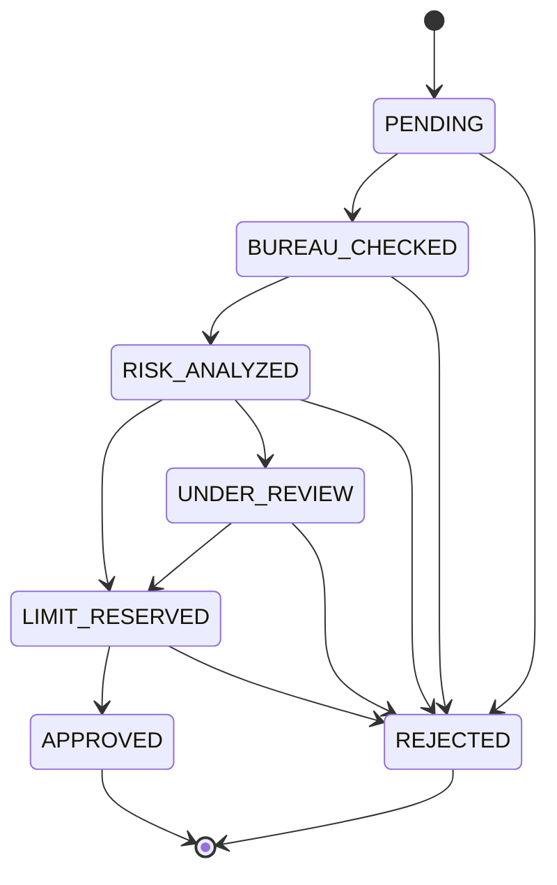
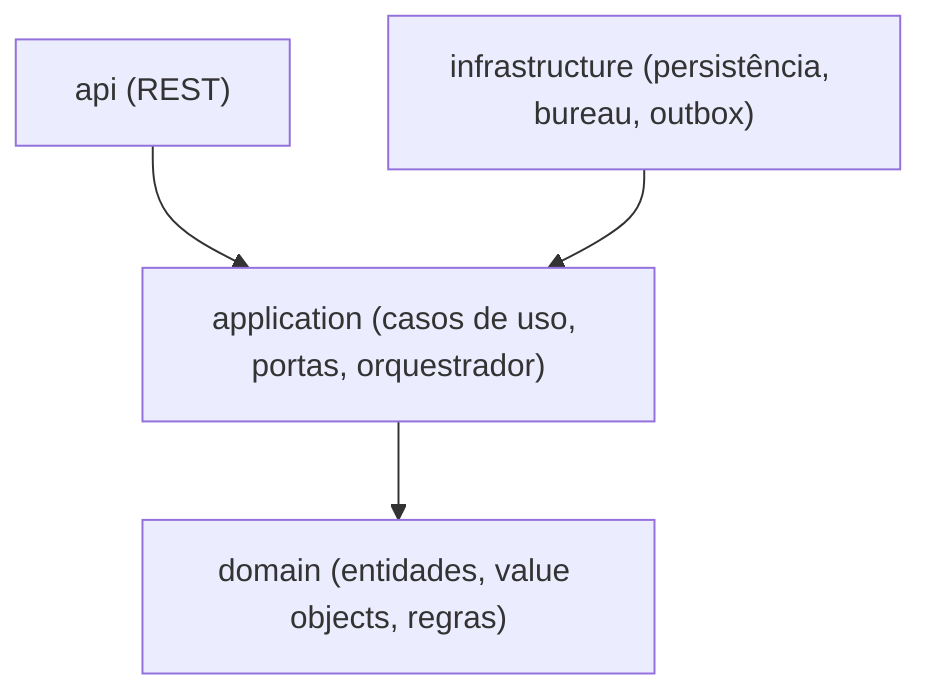

# Alcada

Serviço de aprovação e gestão de linhas de crédito em Java 21 e Spring Boot. Saga orquestrada com compensações, eventos via outbox e requisições idempotentes.

[](https://github.com/nevvesdev/alcada/actions/workflows/ci.yaml)


## Visão geral

O cliente solicita um limite de crédito informando valor, CPF e renda declarada. A solicitação percorre etapas coordenadas por um orquestrador central. Se uma etapa falha, as anteriores são compensadas.

## Fluxo da saga

1. **Solicitação recebida**: status `PENDING`, com chave de idempotência para evitar duplicidade em reenvios.
2. **Consulta ao bureau**: serviço externo simulado de score. Status `BUREAU_CHECKED`.
3. **Análise de risco**: regras sobre score, renda e comprometimento. Pode aprovar, negar ou enviar para revisão. Status `RISK_ANALYZED`.
4. **Reserva de limite**: reserva o valor na conta do cliente. Status `LIMIT_RESERVED`.
5. **Aprovação final**: confirma o limite e emite o evento `CreditLineApproved`. Status `APPROVED`.

### Compensações

- Falha na reserva depois da consulta ao bureau: solicitação `REJECTED` com o motivo registrado.
- Falha na aprovação depois da reserva: a reserva é liberada antes de finalizar.
- Bureau sem resposta: timeout e retry com backoff; esgotadas as tentativas, a solicitação é cancelada.

### Máquina de estados



## Arquitetura

Onion Architecture: as dependências apontam sempre para o centro.



## Garantias da saga

- **Retomável:** o orquestrador decide o próximo passo pelo status persistido, então uma solicitação interrompida continua de onde parou.
- **Idempotente na entrada:** a mesma chave com o mesmo payload devolve a solicitação existente; a mesma chave com payload diferente é recusada.
- **Portas externas idempotentes:** `reserve`, `confirm` e `release` podem ser repetidos com segurança por identificador da solicitação.
- **Compensação explícita:** falha na confirmação do limite libera a reserva antes de rejeitar; se a liberação falhar, a solicitação permanece em `LIMIT_RESERVED` para nova tentativa.
- **Revisão manual:** a saga pausa em `UNDER_REVIEW` até a aprovação ou a negação.

## Integrações e resiliência

Os serviços externos são acessados por adaptadores HTTP das portas `CreditBureauPort` e `LimitReservationPort`.

- **Timeouts** de conexão e de leitura configuráveis por serviço.
- **Retry com backoff exponencial e jitter** apenas para falhas transitórias (timeout, conexão recusada, 5xx, 408 e 429).
- **Circuit breaker** por serviço: com o circuito aberto a chamada falha rápido, sem retry.
- **Erros de negócio (4xx)** não são reenviados e não contam para o circuit breaker.
- **Idempotência:** `reserve` e `confirm` enviam o header `Idempotency-Key` com o identificador da solicitação, e `release` trata 404 como sucesso.

Configuração em `application.yaml`, sobrescrevível por variáveis de ambiente:

```yaml
alcada:
  bureau:
    base-url: ${BUREAU_BASE_URL:http://localhost:8089}
    read-timeout: 2s
    retry:
      max-attempts: 3
      initial-backoff: 200ms
```

## Eventos, outbox e recuperação

- **Eventos de domínio:** `CreditLineApproved` e `CreditLineRejected` nascem no agregado e não carregam dados pessoais.
- **Outbox transacional:** o estado da solicitação e os eventos são gravados na mesma transação. O evento só é limpo do agregado depois do commit.
- **Relay do outbox:** publica em lote usando `FOR UPDATE SKIP LOCKED`, então várias instâncias podem rodar sem publicar o mesmo evento ao mesmo tempo. A entrega é *at-least-once*: consumidores devem deduplicar pelo `eventId`. Eventos que esgotam as tentativas ficam na tabela para inspeção.
- **Recuperação de sagas paradas:** solicitações em `PENDING`, `BUREAU_CHECKED`, `RISK_ANALYZED` ou `LIMIT_RESERVED` sem atualização recente são reivindicadas com um *lease* (`claimed_until`) e retomadas pelo orquestrador. `UNDER_REVIEW` fica de fora, pois aguarda decisão humana.
- **Jobs agendados:** controlados por `alcada.jobs.enabled`, com intervalos configuráveis em `application.yaml`.

```yaml
alcada:
  jobs:
    enabled: true
  recovery:
    interval: PT30S
    stale-after: PT1M
    lease: PT2M
  outbox:
    interval: PT2S
    max-attempts: 10
```

## Stack

Java 21, Spring Boot 4, Spring Data JPA, PostgreSQL, Flyway, Testcontainers, Docker.

## Como executar

Pré-requisitos: Java 21 e Docker.

```bash
docker-compose up -d
./mvnw spring-boot:run
```

Verificação de saúde:

```bash
curl http://localhost:8080/actuator/health
```

Testes (requerem Docker em execução):

```bash
./mvnw verify
```
## Roadmap

- [x] Fase 0: Scaffold, infraestrutura local e CI
- [x] Fase 1: Domínio: solicitação, máquina de estados e regras
- [x] Fase 2: Aplicação: casos de uso, portas e orquestrador da saga
- [x] Fase 3: Persistência: Flyway, JPA e saga state
- [x] Fase 4: Bureau simulado, timeout e retry
- [x] Fase 5: Outbox e publicação de eventos
- [ ] Fase 6: API REST e idempotência
- [ ] Fase 7: Hardening: Docker, métricas, cobertura e README final

## 👨‍💻 Desenvolvido por

João Victor · [GitHub](https://github.com/nevvesdev) · [LinkedIn](https://www.linkedin.com/in/nevvesdev/)

## Licença

MIT. Veja o arquivo [LICENSE](LICENSE).