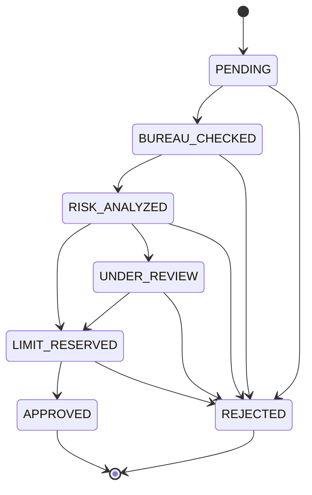
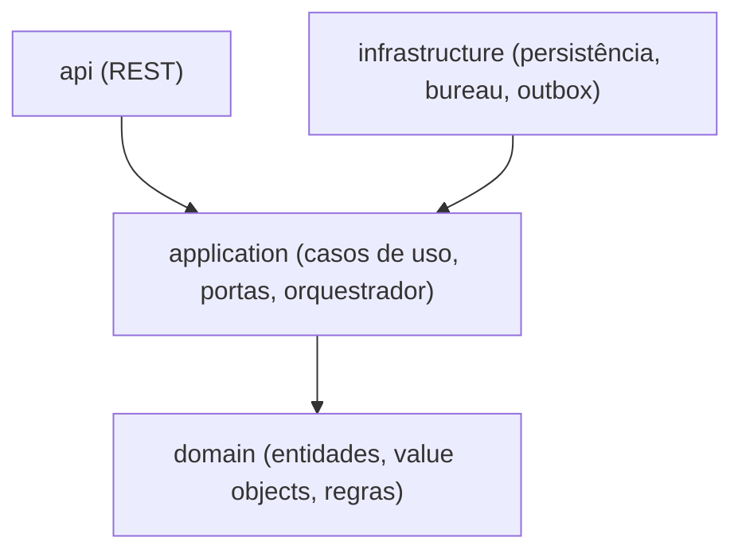

# Alcada

Serviço de aprovação e gestão de linhas de crédito em Java 21 e Spring Boot. Saga orquestrada com compensações, eventos via outbox e requisições idempotentes.

[](https://github.com/nevvesdev/alcada/actions/workflows/ci.yaml)


## Visão geral

O cliente solicita um limite de crédito informando valor, CPF e renda declarada. A solicitação percorre etapas coordenadas por um orquestrador central. Se uma etapa falha, as anteriores são compensadas.

## Fluxo da saga

1. **Solicitação recebida**: status `PENDING`, com chave de idempotência para evitar duplicidade em reenvios.
2. **Consulta ao bureau**: serviço externo simulado de score. Status `BUREAU_CHECKED`.
3. **Análise de risco**: regras sobre score, renda e comprometimento. Pode aprovar, negar ou enviar para revisão. Status `RISK_ANALYZED`.
4. **Reserva de limite**: reserva o valor na conta do cliente. Status `LIMIT_RESERVED`.
5. **Aprovação final**: confirma o limite e emite o evento `CreditLineApproved`. Status `APPROVED`.

### Compensações

- Falha na reserva depois da consulta ao bureau: solicitação `REJECTED` com o motivo registrado.
- Falha na aprovação depois da reserva: a reserva é liberada antes de finalizar.
- Bureau sem resposta: timeout e retry com backoff; esgotadas as tentativas, a solicitação é cancelada.

### Máquina de estados



## Arquitetura

Onion Architecture: as dependências apontam sempre para o centro.



## Stack

Java 21, Spring Boot 4, Spring Data JPA, PostgreSQL, Flyway, Testcontainers, Docker.

## Como executar

Pré-requisitos: Java 21 e Docker.

```bash
docker-compose up -d
./mvnw spring-boot:run
```

Verificação de saúde:

```bash
curl http://localhost:8080/actuator/health
```

Testes (requerem Docker em execução):

```bash
./mvnw verify
```
## Roadmap

- [x] Fase 0: Scaffold, infraestrutura local e CI
- [x] Fase 1: Domínio: solicitação, máquina de estados e regras
- [ ] Fase 2: Aplicação: casos de uso, portas e orquestrador da saga
- [ ] Fase 3: Persistência: Flyway, JPA e saga state
- [ ] Fase 4: Bureau simulado, timeout e retry
- [ ] Fase 5: Outbox e publicação de eventos
- [ ] Fase 6: API REST e idempotência
- [ ] Fase 7: Hardening: Docker, métricas, cobertura e README final

## 👨‍💻 Desenvolvido por

João Victor · [GitHub](https://github.com/nevvesdev) · [LinkedIn](https://www.linkedin.com/in/nevvesdev/)

## Licença

MIT. Veja o arquivo [LICENSE](LICENSE).