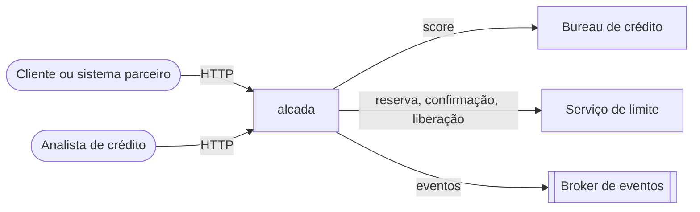
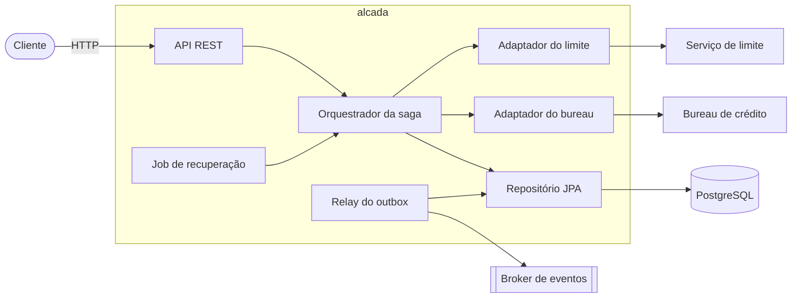
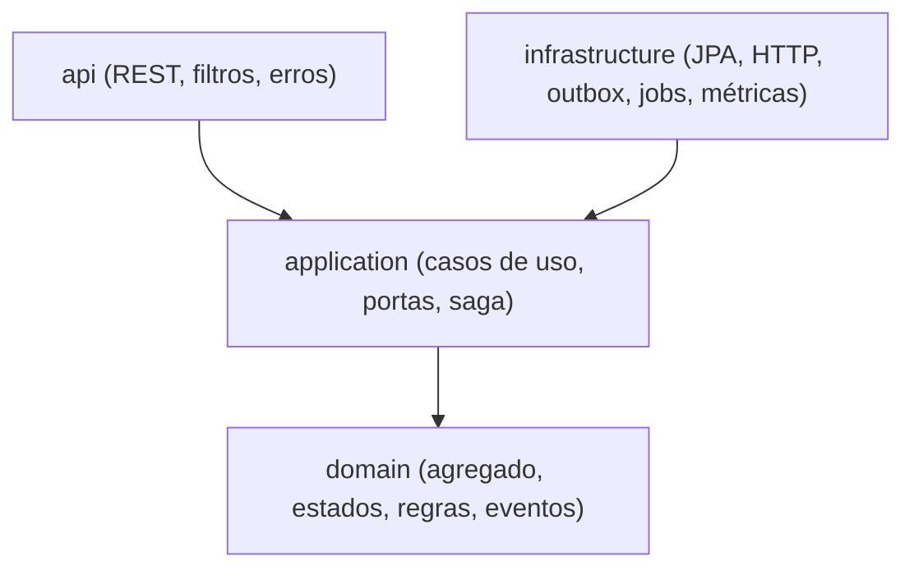
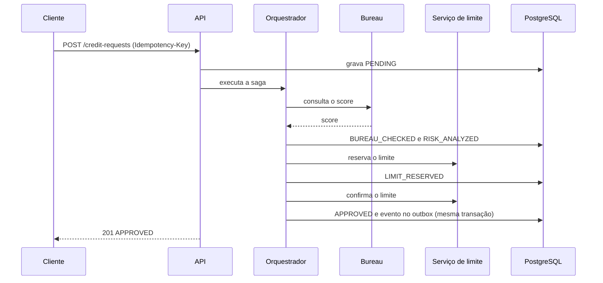
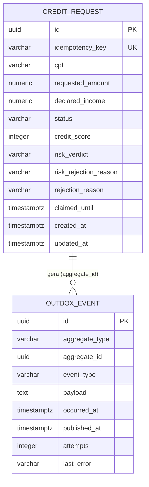

# Alcada · Documento de design

## 1. Contexto e objetivo

Instituições financeiras precisam decidir, em segundos e de forma auditável, se concedem uma linha de crédito. A decisão depende de sistemas externos (bureau de crédito e serviço de limite) que falham, demoram e não participam de transações distribuídas. O alcada coordena essa decisão como uma **saga orquestrada**, com compensações, idempotência e publicação confiável de eventos.

## 2. Requisitos funcionais

| Id | Requisito |
|---|---|
| RF1 | Receber uma solicitação de limite com CPF, valor solicitado e renda declarada. |
| RF2 | Consultar o score do cliente em um bureau externo. |
| RF3 | Avaliar o risco e decidir entre aprovar, negar ou enviar para revisão manual. |
| RF4 | Reservar o limite no serviço de contas e confirmá-lo na aprovação final. |
| RF5 | Compensar etapas anteriores quando uma etapa posterior falha. |
| RF6 | Permitir que um analista aprove ou negue solicitações em revisão. |
| RF7 | Publicar eventos de aprovação e rejeição para outros sistemas. |
| RF8 | Consultar o estado de uma solicitação. |

## 3. Requisitos não funcionais

| Id | Requisito | Como é atendido |
|---|---|---|
| RNF1 | Consistência: nenhuma solicitação fica em estado ambíguo. | Máquina de estados no domínio, estado persistido a cada etapa. |
| RNF2 | Idempotência: reenvios não geram duplicidade. | `Idempotency-Key` com restrição `UNIQUE` (ADR-0004). |
| RNF3 | Resiliência a falhas externas. | Timeout, retry com backoff e jitter, circuit breaker (ADR-0005). |
| RNF4 | Recuperação após queda do processo. | Saga retomável e job de recuperação com lease (ADR-0006). |
| RNF5 | Entrega confiável de eventos. | Outbox transacional, entrega *at-least-once* (ADR-0003). |
| RNF6 | Segurança de dado pessoal. | CPF criptografado em repouso, mascarado em respostas e logs (ADR-0007). |
| RNF7 | Observabilidade. | Métricas Prometheus, correlation id, logs estruturados. |
| RNF8 | Testabilidade e manutenção. | Onion architecture verificada por ArchUnit (ADR-0002). |

## 4. Estimativas de capacidade

Premissas: 1 milhão de solicitações por mês, pico de 20 vezes a média.

| Item | Cálculo | Resultado |
|---|---|---|
| Taxa média | 1.000.000 / (30 · 24 · 3600) | cerca de 0,4 req/s |
| Taxa de pico | 20 × 0,4 | cerca de 8 req/s |
| Duração da saga síncrona | dominada pelo bureau | alvo de p95 abaixo de 3 s |
| Requisições simultâneas no pico | 8 req/s × 3 s | cerca de 24 |
| Chamadas externas por solicitação | 1 bureau + 2 de limite (3 com compensação) | 3 a 4 |
| Escritas no banco por solicitação | 1 por etapa + 1 evento | 6 a 8 |
| Armazenamento | cerca de 1,1 KB por solicitação (linha + evento) | cerca de 1,1 GB por mês, mais índices |

Nenhuma transação de banco fica aberta durante chamadas HTTP: o pool de conexões (10 por padrão) só é usado em escritas curtas, então 24 requisições simultâneas cabem com folga.

## 5. Arquitetura

### 5.1 Visão de contexto

### 5.2 Visão de contêineres e componentes

### 5.3 Camadas

## 6. Fluxo da saga

### Compensações

| Falha | Ação |
|---|---|
| Bureau indisponível após retries | `REJECTED (BUREAU_UNAVAILABLE)` |
| Score baixo ou renda incompatível | `REJECTED` com o motivo da decisão de risco |
| Reserva de limite recusada ou indisponível | `REJECTED (LIMIT_RESERVATION_FAILED)`, sem nada a desfazer |
| Confirmação do limite falha | Libera a reserva e `REJECTED (APPROVAL_FAILED)` |
| Liberação da reserva falha | A exceção sobe, a solicitação permanece em `LIMIT_RESERVED` e é retomada pela recuperação |

## 7. Modelo de dados

## 8. Modos de falha

| Cenário | Efeito | Mitigação |
|---|---|---|
| Processo cai no meio da saga | Solicitação parada em estado intermediário | Job de recuperação reivindica com lease e retoma pelo status persistido |
| Cliente reenvia a mesma requisição | Risco de duplicidade | Idempotência por chave; repetição devolve o estado atual |
| Duas requisições disputam a mesma chave | Corrida na criação | Restrição `UNIQUE`; a perdedora devolve a vencedora |
| Broker fora do ar | Eventos não publicados | Eventos permanecem no outbox; retentativas com limite e métrica de eventos "mortos" |
| Serviço externo lento | Threads presas | Timeouts de conexão e leitura, retry limitado, circuit breaker |
| Serviço externo fora do ar | Cascata de falhas | Circuit breaker abre e a chamada falha rápido |
| Dois workers processam a mesma solicitação | Efeitos duplicados | Lease com `SKIP LOCKED` e portas externas idempotentes por identificador |
| Vazamento do banco | Exposição de CPF | CPF criptografado em repouso; eventos sem dado pessoal |

## 9. Decisões de arquitetura

Veja a pasta [`docs/adr`](adr).

## 10. Limitações e evolução

- A API não tem autenticação nem autorização; em produção ela ficaria atrás de um gateway com OAuth2.
- O publicador de eventos padrão apenas registra em log. A troca por Kafka ou RabbitMQ é a implementação de uma interface.
- A saga é síncrona na requisição. Para volumes maiores, o `POST` pode devolver `202` e delegar a execução a workers consumindo a mesma lógica da recuperação.
- A rotação de chave do CPF exige uma migração de re-cifragem (prefixo `enc:v2:`).
- Limites de taxa (*rate limiting*) são responsabilidade do gateway.